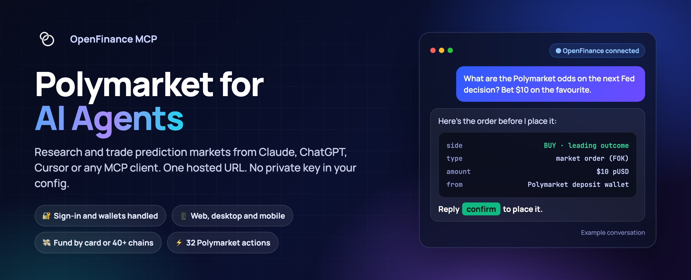
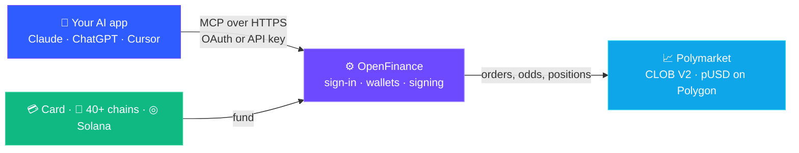
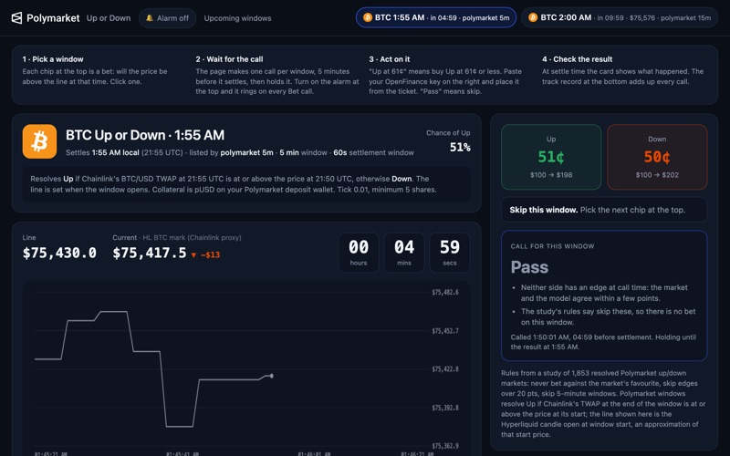

<div align="center">

<a href="https://openfinance.tech/agents/trade-polymarket-with-claude"></a>

# Polymarket for AI Agents

**Research and trade Polymarket from Claude, ChatGPT, Cursor or any AI agent, through one hosted MCP server.**<br />
OpenFinance handles the sign-in, the wallet and the Polymarket plumbing. No private key in your config, nothing to install.

<sub>Built by OpenFinance. Independent; not affiliated with or endorsed by Polymarket.</sub>

[](#quick-start)
[](#quick-start)
[](#what-your-agent-can-do)
[](#fund-your-polymarket-wallet)
[](./LICENSE)

<sub>WORKS WITH</sub><br />


**[Quick start](#quick-start)** · **[Why OpenFinance](#why-openfinance)** · **[Fund](#fund-your-polymarket-wallet)** · **[Tools](#what-your-agent-can-do)** · **[Safety](#safety)** · **[FAQ](#faq)** · **[For AI agents](#for-ai-agents)**

</div>

## ⚡ Get Polymarket in one step

**Option 1: install the skills** (Claude Code, Cursor, Codex and most coding agents)

```bash
npx skills add openfinance-tech/skills -y
```

**Option 2: add the MCP server** to any AI app or agent (Claude, ChatGPT, Grok, Meta Muse, OpenClaw, Hermes, Cursor…)

```text
https://api.openfinance.tech/agent/mcp
```

Sign in with OpenFinance when asked, then ask: *"What are the Polymarket odds on the next Fed rate decision?"* That's it. [Step-by-step for each app →](#quick-start)

> [!IMPORTANT]
> This server places real Polymarket orders with real money. Your agent shows you a summary and waits for your go-ahead before every order. Polymarket isn't available in some countries; OpenFinance doesn't get around that.

### At a glance

| | |
|---|---|
| **MCP URL** | `https://api.openfinance.tech/agent/mcp` |
| **Transport** | Streamable HTTP (hosted, nothing to install) |
| **Sign-in** | OAuth 2.1, or the header `x-api-key: open_...` |
| **Tool** | `polymarket`, with an `action` parameter (32 actions) |
| **Money** | pUSD on Polygon, in your Polymarket deposit wallet |
| **Fee** | 0.25% per trade, on top of Polymarket's own fees |
| **Works in** | Claude (web, desktop, mobile), ChatGPT, Grok, Meta Muse, OpenClaw, Hermes Agent, Cursor, VS Code, Codex, Gemini CLI, Windsurf and any MCP client |

---

<a name="why-openfinance"></a>

## ✨ Why OpenFinance

<table>
  <tr>
    <td width="33%" valign="top">
      <h3>🔐 We handle the wallet</h3>
      Sign in and trade. No private key in a config file, no deposit-contract setup, no signature types, no CLOB API keys.
    </td>
    <td width="33%" valign="top">
      <h3>📱 Works everywhere</h3>
      One hosted URL for Claude on web, desktop and mobile, ChatGPT, Grok, Meta Muse, agents like OpenClaw and Hermes, and any MCP client.
    </td>
    <td width="33%" valign="top">
      <h3>💸 Fund from anywhere</h3>
      Deposit pUSD, move funds from your other wallets on 40+ chains or Solana, or pay by debit card.
    </td>
  </tr>
  <tr>
    <td width="33%" valign="top">
      <h3>🔎 Research any market or trader</h3>
      Leaderboards by category, plus any wallet's positions, trades and P&amp;L. Live odds, order books and spreads.
    </td>
    <td width="33%" valign="top">
      <h3>⚡ Gas-free cash-out</h3>
      Claim winnings, convert USDC.e and withdraw to your own wallet on the chains Polymarket's bridge supports, gas-free.
    </td>
    <td width="33%" valign="top">
      <h3>🏗️ Build your own app</h3>
      Turn a prompt into a Polymarket tool in the OpenFinance app and trade it with your own key.
    </td>
  </tr>
</table>

### OpenFinance vs a typical local Polymarket MCP server

| | Typical open-source local server | **OpenFinance** |
|---|:---:|:---:|
| Nothing to run on your computer | ❌ A local process (for example npx with Node 20+) | ✅ One URL |
| No private key in your config | ❌ Key in a config or `.env` file | ✅ OAuth or a revocable API key |
| Polymarket wallet setup done for you | ❌ Log in to polymarket.com once, then set your funder address and signature type | ✅ Automatic |
| Works in Claude mobile, claude.ai and ChatGPT | ❌ Local apps only | ✅ |
| Fund by card or from other chains | ❌ Bring pUSD on Polygon | ✅ |
| Gas-free cash-out to other chains | ❌ | ✅ To your own wallets |
| Polymarket upgrades handled for you (CLOB V2, pUSD) | ❌ Wait for the maintainer to ship an update | ✅ On the server |
| A leaked key can't transfer your funds to someone else | ❌ It's your wallet's private key | ✅ It can still trade ([see FAQ](#faq)) |
| Leaderboards and any wallet's positions | ➖ Mostly your own account | ✅ |
| Hyperliquid perps (including stock and FX perps) and memecoins in the same account | ❌ | ✅ |

> [!NOTE]
> **Where others are ahead.** A local open-source server keeps your key on your own machine, and you can read its code and browse markets without an account. OpenFinance is hosted and closed source, signs on its servers, and has one key per account with no read-only scope yet. It also doesn't support Kalshi, doesn't enforce trade-size limits on the server, and charges 0.25% per Polymarket trade on top of Polymarket's fees. Paper trading works by asking your agent (see [Paper trading](#paper-trading)).
>
> <sub>"Typical open-source local server" is based on the READMEs of popular open-source Polymarket MCP servers, checked in November 2026.</sub>

### 🧭 How it works



---

<a name="quick-start"></a>

## 🚀 Quick start

**1. Create your account.** Sign in at [openfinance.tech](https://openfinance.tech). Your wallets are created for you.

**2. Add the server to your AI app.**

<details open>
<summary><b>🟠 Claude (web, desktop and mobile)</b></summary>

1. On claude.ai, open **Settings → Connectors** and click **Add custom connector**.
2. Name: `OpenFinance`. URL: `https://api.openfinance.tech/agent/mcp`.
3. Click **Add**, then **Connect**, and approve the connection on OpenFinance.
4. In a chat, open the tools menu and switch **OpenFinance** on.

The connector then works in the Claude web, desktop and mobile apps. Custom connectors are available on Claude's paid plans.

</details>

<details>
<summary><b>🟢 ChatGPT</b></summary>

1. Open **Settings → Apps & Connectors**. If you don't see **Create**, turn on **Developer mode** under **Advanced settings**.
2. Click **Create**. Name: `OpenFinance`. URL: `https://api.openfinance.tech/agent/mcp`. Authentication: **OAuth**.
3. Sign in to OpenFinance and approve. In a new chat, pick **OpenFinance** from the tools menu.

Custom connectors need a ChatGPT plan that supports them (Plus, Pro, Business, Enterprise or Edu).

</details>

<details>
<summary><b>⌨️ Claude Code</b></summary>

```bash
claude mcp add --transport http openfinance-tech https://api.openfinance.tech/agent/mcp
```

Run `/mcp`, choose **openfinance-tech** and select **Authenticate**. For an API key instead, use [`examples/claude-code/.mcp.json`](./examples/claude-code/.mcp.json).

</details>

<details>
<summary><b>⚫ Cursor</b></summary>

<a href="https://cursor.com/en/install-mcp?name=openfinance-tech&config=eyJ1cmwiOiJodHRwczovL2FwaS5vcGVuZmluYW5jZS50ZWNoL2FnZW50L21jcCJ9"></a>

Or copy [`examples/cursor/mcp.json`](./examples/cursor/mcp.json) to `~/.cursor/mcp.json`. Cursor shows **Needs login**; click it to sign in.

</details>

<details>
<summary><b>✖️ Grok (grok.com and Grok CLI)</b></summary>

1. Open **grok.com/connectors**, click **New Connector**, then **Custom**.
2. Name it `OpenFinance`, paste `https://api.openfinance.tech/agent/mcp` and complete the sign-in.
3. Test it: *"List the OpenFinance tools. Do not place any orders."*

On Grok Business, an admin adds it first in console.x.ai. With the Grok CLI:

```bash
grok mcp add --transport http openfinance-tech https://api.openfinance.tech/agent/mcp \
  --header "x-api-key: ${OPENFINANCE_API_KEY}"
```

</details>

<details>
<summary><b>🔵 Meta Muse</b></summary>

1. In Muse (app, web or WhatsApp), start a new chat.
2. Add a custom connector named `OpenFinance` for `https://api.openfinance.tech/agent/mcp` (remote streamable HTTP), or install the skill file `https://openfinance.tech/skill.md`.
3. Sign in with OAuth, or put your API key in Muse's Secure Credentials Store, never in the chat.
4. Say *"list the OpenFinance tools"* to test, then *"save this connector as a skill"*.

Meta doesn't review custom connectors you add yourself, and they still work.

</details>

<details>
<summary><b>🦞 OpenClaw</b></summary>

```bash
openclaw mcp add openfinance-tech \
  --url https://api.openfinance.tech/agent/mcp \
  --transport streamable-http
openclaw mcp doctor openfinance-tech --probe
```

OpenClaw treats remote servers as SSE unless you set `streamable-http`, so keep that flag. To use an API key, add it as a header in the Control UI's config editor with a `${OPENFINANCE_API_KEY}` reference, or copy [`examples/openclaw/openclaw.json`](./examples/openclaw/openclaw.json) into `~/.openclaw/openclaw.json` (servers sit under `mcp.servers`).

</details>

<details>
<summary><b>🪽 Hermes Agent</b></summary>

```bash
hermes mcp add openfinance-tech --url https://api.openfinance.tech/agent/mcp
```

Or add it to `~/.hermes/config.yaml` ([`examples/hermes/config.yaml`](./examples/hermes/config.yaml)), then run `/reload-mcp` or restart the agent.

</details>

<details>
<summary><b>🔷 VS Code, Codex, Claude Desktop with a key, and others</b></summary>

Ready-to-copy configs are in [`examples/`](./examples). Every client, with OAuth and API-key options, is in the [OpenFinance MCP setup guide](https://github.com/openfinance-tech/mcp#install-in-your-ai-client).

</details>

**3. Ask.**

```text
Using OpenFinance, what are the Polymarket odds on the next Fed rate decision?
```

---

<a name="fund-your-polymarket-wallet"></a>

## 💰 Fund your Polymarket wallet

Polymarket trades from a **deposit wallet**, a smart-contract wallet that holds pUSD. OpenFinance creates it for you. It's separate from your main OpenFinance wallet, so first ask your agent: *"What's my Polymarket deposit wallet and balance?"*

| | Way | How |
|:---:|---|---|
| 🪙 | **pUSD directly** | Send pUSD on Polygon to your deposit wallet. |
| 🔗 | **From your other wallets** | Ask your agent to move USDC from any of your OpenFinance wallets, on 40+ chains or Solana. It bridges the funds into your deposit wallet. |
| 💳 | **Debit card or bank** | Buy USDC by card or bank transfer (ask your agent for a checkout link, or use the OpenFinance app). It lands in your OpenFinance wallet; then ask your agent to move it to Polymarket. UPI works in India. |

> [!WARNING]
> Send only **pUSD on Polygon**, and only to the **deposit wallet**, not your main OpenFinance address. pUSD on your main address can't be used for trading until it's moved over, and other tokens or networks may be lost. (USDC.e on Polygon can be converted with `wrap_collateral`.)

> [!TIP]
> Winnings and bridged-in funds can arrive as **USDC.e**. Ask your agent to convert them to pUSD (`wrap_collateral`, gas-free). To cash out, ask it to withdraw: `withdraw_and_bridge` sends pUSD to your own wallet on a chain and token that Polymarket's bridge supports (such as Ethereum, Base, Arbitrum or Solana), gas-free. Polymarket's bridge may charge its own fees.

---

<a name="what-your-agent-can-do"></a>

## 🛠️ What your agent can do

Everything sits behind one MCP tool, `polymarket`, with an `action` parameter. Actions marked ✍️ change state, and your agent confirms them with you first.

| | Group | Actions | What for |
|:---:|---|---|---|
| 🔍 | **Discover** | `search`, `get_events`, `get_event`, `get_event_live_volume`, `get_markets`, `get_market`, `get_market_stats` | Find markets by keyword, event or slug; volume, liquidity and open interest |
| 📊 | **Prices** | `get_orderbooks`, `get_prices`, `get_spread`, `get_last_trade_price`, `get_market_trades` | Live odds, order books, spreads and the trade tape |
| 🏆 | **Traders** | `get_leaderboard` | Top traders by P&L or volume, by category and period |
| 👛 | **Any wallet** | `get_user_positions`, `get_user_closed_positions`, `get_user_activity`, `get_user_trades`, `get_user_portfolio`, `get_user_pnl` | Positions, trades and P&L for your wallet or any trader's |
| 🎯 | **Orders** | ✍️ `place_order`, ✍️ `place_market_order`, ✍️ `place_orders`, ✍️ `cancel`, `get_order`, `get_user_orders`, `get_order_scoring` | Limit, market and batch orders; cancel one, many, all or by market; reward scoring |
| 💼 | **Wallet** | `get_deposit_wallet`, ✍️ `wrap_collateral`, ✍️ `withdraw_and_bridge`, ✍️ `redeem`, ✍️ `redeem_all` | Balances; convert USDC.e; cash out to other chains; claim winnings |
| 🧾 | **Builder** | `get_builder_trades` | Trades attributed to OpenFinance's builder code |

<details>
<summary><b>📐 Order parameters</b></summary>

| Action | Parameters |
|---|---|
| `place_order` (limit) | `tokenID`, `price` (probability 0 to 1), `size`, `side` (`BUY` or `SELL`), optional `orderType` (`GTC` or `GTD`), `tickSize`, `negRisk`, `postOnly`, `expiration` (Unix seconds, needed for `GTD`) |
| `place_market_order` | `tokenID`, `amount` (BUY: pUSD to spend; SELL: shares to sell), `side`, optional `price`, `orderType` (`FOK`, the default, or `FAK`), `tickSize`, `negRisk` |
| `place_orders` | `orders`: a list of limit orders with the fields above, optional `postOnly` |
| `cancel` | `scope`: `one` (with `orderId`), `many` (with `orderHashes`), `all`, or `market` (with `market` or `asset_id`) |

Your agent finds `tokenID`, `tickSize` and `negRisk` with `get_market` before placing an order.

</details>

The same account also trades Hyperliquid perps and spot (including stock and FX perps), Hyperliquid Yes/No outcome markets, onchain swaps and memecoins. See the [full tool reference](https://github.com/openfinance-tech/mcp#tool-reference).

---

<a name="a-sample-session"></a>

## 💬 A sample session

<sub>An example of how a conversation goes. Real markets, odds and balances will differ.</sub>

> 🧑 **You:** Using OpenFinance, what are the Polymarket odds on the next Fed rate decision?
>
> 🤖 **Agent:** *(searches Polymarket, reads the order book)* Here's the market, the price of each outcome, and the spread on the leading one.
>
> 🧑 **You:** Bet $10 on the favourite.
>
> 🤖 **Agent:** Here's the order before I place it: **BUY** the leading outcome, market order (it fills now in full or not at all), **$10 of pUSD** from your Polymarket deposit wallet. OpenFinance's fee is 0.25% on top of Polymarket's. Reply **"confirm"** to place it.
>
> 🧑 **You:** confirm
>
> 🤖 **Agent:** ✅ Placed. Here's the fill: shares bought and the average price. Want me to show your open positions?

**More prompts to try**

```text
Who are the top 10 Polymarket sports traders this week, and what is the #1 wallet holding?
```
```text
Show my open Polymarket positions and my P&L this month.
```
```text
Redeem all my resolved Polymarket winnings, then convert them to pUSD.
```
```text
Cash out $50 of pUSD to my USDC on Base.
```

---

<a name="paper-trading"></a>

## 🧪 Paper trading

> [!TIP]
> Your agent can paper-trade for you. Read-only actions don't move money, so it can research and track a paper portfolio safely. Ask Claude, ChatGPT or Codex:

```text
Paper-trade Polymarket for me. Use live prices from OpenFinance, keep a ledger of every bet you'd place and its result, and don't place any real order until I say "go live".
```

---

<a name="safety"></a>

## 🛡️ What your agent can and can't do with your money

| | |
|:---:|---|
| ✅ | **Your agent confirms every order with you first.** It shows a summary and waits for your go-ahead, such as replying "confirm". That's the agent's behaviour, not a server block, so keep your AI app's tool-approval prompts on as a second check. |
| 🔒 | **It can move funds only between your own wallets.** Cashing out and bridging go to your own addresses. Sending to anyone else needs your sign-in on openfinance.tech and a code from your authenticator app. |
| ⚠️ | **It can still trade.** A bad trade can lose money, and there are no server-side trade limits. Fund only what you're willing to risk. |
| 🔑 | **Your wallets are yours.** Export the private keys from Settings → Export Keys, with a code from your authenticator app. |

**🧯 Two things to try that should fail**

1. ❌ Ask your agent to send pUSD to an address that isn't yours. Your agent or the server refuses it (`403 EXTERNAL_RECIPIENT_NOT_ALLOWED`).
2. ❌ Replace your API key on the **External AI** page, then try the old key. It stops working at once. Replacing the key also ends every OAuth connection, so reconnect your apps afterwards.

Confirmation before an order is your agent's behaviour, not a server block. Keep your AI app's tool-approval prompts on as the check that doesn't depend on the model.

---

<a name="build-your-own-app"></a>

## 🏗️ Build your own Polymarket app

In the OpenFinance app you can build a Polymarket tool from one prompt and trade it with your own key. **Poly Up/Down Assist** is one of the blueprints: one call per BTC and ETH up-or-down window, with an alarm and a track record. The gallery shows a demo; build your own copy in OpenFinance to trade with it.

<a href="https://openfinance.tech/mainframe"></a>

See more in the [blueprint gallery](https://openfinance.tech/mainframe).

---

<a name="run-the-examples"></a>

## 🧑‍💻 Run the examples

Read-only scripts that connect with your API key, search Polymarket and print the top markets with their odds. They never place orders.

```bash
export OPENFINANCE_API_KEY="open_..."   # from openfinance.tech → External AI

# TypeScript
cd examples/typescript && npm install && npx tsx list-markets.ts "bitcoin"

# Python 3.10+
pip install mcp && python3 examples/python/list_markets.py "bitcoin"
```

Check the server is reachable without a key (a `401` is expected):

```bash
./scripts/check-connection.sh
```

---

<a name="troubleshooting"></a>

## 🩺 Troubleshooting

| Problem | Fix |
|---|---|
| `401 Unauthorized` | Not signed in, or the key is wrong. Re-run your app's sign-in, or copy the key again from **External AI** (it starts with `open_`). |
| The tools don't appear | Most apps read MCP settings at startup. Fully quit and reopen, or reload the servers. |
| An order is rejected for funds | Orders spend pUSD in your deposit wallet, not your main wallet. Ask *"What's my Polymarket deposit wallet and balance?"* and fund it. |
| You hold USDC.e but can't trade it | Ask your agent to convert it to pUSD (`wrap_collateral`). |
| A withdrawal, redeem or conversion says **pending** | It was accepted and is confirming on Polymarket's relayer. Don't repeat it, or it may run twice. Check again in a minute. |
| A pending **order** | Unlike withdrawals, a pending order was **not** placed: only its wallet setup is confirming. Place it again once that finishes. |
| A withdrawal hasn't arrived | Polymarket's bridge delivers it. Share the transfer hash from your agent with Polymarket support. |
| `403 EXTERNAL_RECIPIENT_NOT_ALLOWED` | Agents can only move funds between your own wallets. Send to someone else from the Wallet page on openfinance.tech. |
| Polymarket says the region is restricted | Polymarket isn't available where you are. OpenFinance can't change that. |

---

<a name="faq"></a>

## ❓ FAQ

<details>
<summary><b>What does it cost?</b></summary>

OpenFinance charges 25 basis points (0.25%) per Polymarket trade, on top of Polymarket's own fees. There's no charge to connect.

</details>

<details>
<summary><b>Do I need KYC?</b></summary>

Not on OpenFinance. If you buy crypto by card, the card provider may ask for ID on its side.

</details>

<details>
<summary><b>Does it support Kalshi?</b></summary>

No. OpenFinance supports Polymarket and Hyperliquid's Yes/No outcome markets.

</details>

<details>
<summary><b>Can I set a maximum bet size?</b></summary>

Not on the server. Tell your agent your limits in a standing instruction (for example *"never bet more than $20 on one market"*) and keep your app's approval prompts on. That's a request to the model, not a block on the server.

</details>

<details>
<summary><b>Can someone with my API key take my money?</b></summary>

Not by transfer: a key can only move funds between your own wallets. It can still trade, including against orders an attacker placed, which can lose money to them. There are no server-side trade limits, so keep it private, fund only what you're willing to risk, and replace it on the **External AI** page if it leaks.

</details>

<details>
<summary><b>Is the server open source?</b></summary>

No. The server is hosted by OpenFinance. This repository (the docs, example configs and scripts) is MIT-licensed.

</details>

---

<a name="for-ai-agents"></a>

## 🤖 For AI agents

Read [**AGENTS.md**](./AGENTS.md) first: how to connect, which action to call for each request, and the rules for money. A plain-text summary is in [**llms.txt**](./llms.txt). The short version:

1. Connect to `https://api.openfinance.tech/agent/mcp` (Streamable HTTP, OAuth or `x-api-key`).
2. Call `polymarket` with `get_deposit_wallet` before anything about the user's balance or funding.
3. Show a summary and wait for the user's go-ahead before every ✍️ action.
4. Funds only move between the user's own wallets.

---

<a name="related"></a>

## 🔗 Related

- [**OpenFinance MCP server**](https://github.com/openfinance-tech/mcp): every market and every AI client
- [**OpenFinance skills**](https://github.com/openfinance-tech/skills): `openfin-polymarket` teaches agents multi-outcome markets, tick sizes and the deposit wallet (`npx skills add openfinance-tech/skills -y`)
- [How to trade Polymarket with Claude](https://openfinance.tech/agents/trade-polymarket-with-claude) · [Polymarket MCP server](https://openfinance.tech/agents/polymarket-mcp-server)
- [Security: what an agent can and can't do](https://openfinance.tech/security)

<sub>⚠️ Prediction markets carry a real risk of loss. Nothing in this repository or in the server's responses is financial, investment or legal advice. AI agents make mistakes: review every order before you confirm it. Polymarket isn't available everywhere; you're responsible for following the laws where you live. Licensed under [MIT](./LICENSE).</sub>
